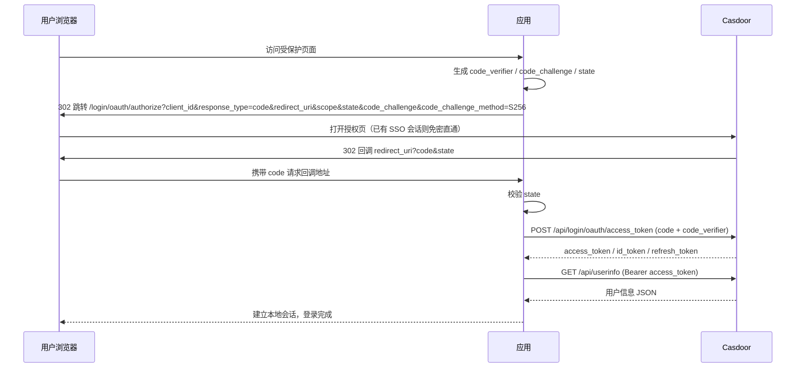

# Casdoor OAuth 2.0 免密认证登录 API 接口文档

> 版本：v1.0 ｜ 适用对象：需要接入 Casdoor 统一认证（SSO 免密登录）的应用
> 协议：OAuth 2.0 / OpenID Connect

## 1. 概述

**免密登录**：应用不自行处理用户密码，而是将用户浏览器重定向到 Casdoor 统一认证中心完成登录。用户在 Casdoor 登录一次后即建立 SSO 会话，访问其他已接入应用时**无需再次输入密码**，直接自动授权并返回。应用通过 OAuth 2.0 **授权码模式（Authorization Code）** 获取访问令牌和用户身份。

```
用户 ──访问──► 应用
应用 ──302 重定向──► Casdoor 登录页（用户输入密码 或 已有 SSO 会话直接免密）
Casdoor ──302 携带 code 回调──► 应用
应用 ──POST code──► Casdoor Token 端点 ──► 返回 access_token / id_token
应用 ──Bearer token──► /api/userinfo 获取用户信息，完成登录
```

## 2. 对接前准备

在 Casdoor 管理后台完成以下配置：

| 配置项 | 说明 |
|---|---|
| **Client ID** | 应用唯一标识（应用编辑页可见） |
| **Client Secret** | 应用密钥，仅服务端使用，禁止下发给前端 |
| **Redirect URI** | 应用回调地址（必须与授权请求中的 `redirect_uri` **完全一致**，含协议/端口/路径） |
| **Grant Types** | 勾选 `authorization_code`、`refresh_token`（如需密码直连再加 `password`） |
| **Token expire hours** | access_token 有效期（小时），默认 168（7 天） |
| **Enable auto signin** | 开启后，用户已登录 Casdoor 时访问授权端点**直接免密下发 code**（免密 SSO 核心） |

## 3. 端点总览

以 Casdoor 部署地址为 `{ENDPOINT}`（如 `https://sso.example.com`）：

| 端点 | 方法 | 说明 |
|---|---|---|
| `{ENDPOINT}/login/oauth/authorize` | GET | 授权端点（浏览器重定向） |
| `{ENDPOINT}/api/login/oauth/access_token` | POST | 令牌端点（换 code / 密码模式 / 刷新） |
| `{ENDPOINT}/api/login/oauth/refresh_token` | POST | 刷新令牌 |
| `{ENDPOINT}/api/userinfo` | GET | 获取用户信息 |
| `{ENDPOINT}/api/login/oauth/introspect` | POST | 令牌内省（服务端校验令牌有效性） |
| `{ENDPOINT}/api/logout` | GET/POST | 登出 |
| `{ENDPOINT}/.well-known/openid-configuration` | GET | OIDC 发现文档（自动获取上述端点） |
| `{ENDPOINT}/.well-known/jwks` | GET | JWT 公钥（本地验签用） |

## 4. 授权码模式对接（推荐，免密登录主流程）

### 4.1 步骤一：重定向用户到授权端点

**接口**

```http
GET {ENDPOINT}/login/oauth/authorize
```

**请求参数（Query）**

| 参数 | 必填 | 说明 |
|---|---|---|
| `client_id` | 是 | 应用的 Client ID |
| `response_type` | 是 | 固定填 `code` |
| `redirect_uri` | 是 | 回调地址，须与应用中登记的完全一致 |
| `scope` | 否 | 申请的权限范围，如 `openid profile email`；留空使用应用默认 |
| `state` | 建议 | 随机字符串，防 CSRF，回调时原样返回，应用**必须校验** |
| `nonce` | 否 | 随机串，会写入 id_token，用于防重放 |
| `code_challenge` | 否 | PKCE 值，见第 6 节（SPA/移动端建议启用） |
| `code_challenge_method` | 否 | 固定 `S256`（仅支持 S256） |

**示例**

```http
GET https://sso.example.com/login/oauth/authorize?client_id=294b09fbc673b5985ee5&response_type=code&redirect_uri=https%3A%2F%2Fapp.example.com%2Fcallback&scope=openid+profile+email&state=xyz123
```

用户在 Casdoor 完成认证（已有 SSO 会话则免密直通），浏览器被 302 重定向回：

```http
https://app.example.com/callback?code=xxxxx&state=xyz123
```

### 4.2 步骤二：处理回调

应用回调接口需要：

1. 校验 `state` 与发起时一致（防 CSRF）；
2. 取出 `code`（**有效期 5 分钟，且只能使用一次**）；
3. 立即执行步骤三换取令牌。

### 4.3 步骤三：用授权码换取令牌

**接口**

```http
POST {ENDPOINT}/api/login/oauth/access_token
Content-Type: application/json
```

**请求参数（Body，支持 JSON / Form / Query）**

| 参数 | 必填 | 说明 |
|---|---|---|
| `grant_type` | 是 | 固定 `authorization_code` |
| `client_id` | 是* | 应用 Client ID（用 Basic Auth 时可省略） |
| `client_secret` | 是* | 应用密钥（用 Basic Auth 时可省略；启用 PKCE 的公开客户端可为空） |
| `code` | 是 | 步骤二获取的授权码 |
| `code_verifier` | 否 | PKCE 校验串（发起时带了 `code_challenge` 则必填） |

> 客户端认证三选一：Body 明文传参 / Query 传参 / **HTTP Basic Auth**（`Authorization: Basic base64(client_id:client_secret)`，推荐）。

**请求示例**

```bash
curl -X POST https://sso.example.com/api/login/oauth/access_token \
  -u "294b09fbc673b5985ee5:client_secret_xxx" \
  -d "grant_type=authorization_code" \
  -d "code=xxxxx" \
  -d "code_verifier=xxx"   # 未使用 PKCE 时省略
```

**成功响应（HTTP 200）**

```json
{
  "access_token": "eyJhbGciOiJSUzI1NiIs...",
  "id_token": "eyJhbGciOiJSUzI1NiIs...",
  "refresh_token": "xxxxx",
  "token_type": "Bearer",
  "expires_in": 604800,
  "scope": "openid profile email"
}
```

| 字段 | 说明 |
|---|---|
| `access_token` | 访问令牌（JWT 格式），调用 API 的凭证 |
| `id_token` | OIDC 身份令牌（JWT），含用户身份声明，可用 JWKS 验签 |
| `refresh_token` | 刷新令牌，用于过期后换取新 token |
| `token_type` | 固定 `Bearer` |
| `expires_in` | 有效期（秒），由应用 `expireInHours` 配置决定，默认 168h = 604800 |

**失败响应（HTTP 400 / 401）**

```json
{
  "error": "invalid_grant",
  "error_description": "authorization code has expired"
}
```

### 4.4 步骤四：获取用户信息

**接口**

```http
GET {ENDPOINT}/api/userinfo
Authorization: Bearer {access_token}
```

**成功响应（HTTP 200）**

```json
{
  "sub": "admin",
  "iss": "https://sso.example.com",
  "aud": "294b09fbc673b5985ee5",
  "preferred_username": "admin",
  "name": "Admin",
  "email": "admin@example.com",
  "email_verified": true,
  "picture": "https://cdn.casbin.org/img/casbin.svg",
  "phone": "+8613800000000",
  "address": "Beijing",
  "real_name": "张三",
  "is_verified": true,
  "groups": ["admin_group"],
  "roles": ["admin"],
  "permissions": ["/api/user"]
}
```

| 字段 | 说明 |
|---|---|
| `sub` | 用户唯一标识（组织内用户名） |
| `iss` | 签发方（Casdoor 地址） |
| `aud` | 受众（即 Client ID） |
| `preferred_username` / `name` | 用户名 / 显示名 |
| `email` / `email_verified` | 邮箱及是否已验证 |
| `picture` / `phone` / `address` | 头像、手机号、地址（需 `profile`/`email`/`phone` scope） |
| `groups` / `roles` / `permissions` | 用户组、角色、权限（需对应 scope） |

> 返回字段按请求的 `scope` 裁剪，仅申请到的 scope 对应字段会返回。

## 5. 刷新令牌

access_token 过期后，无需用户重新登录，用 refresh_token 换新令牌：

**接口**

```http
POST {ENDPOINT}/api/login/oauth/refresh_token
Content-Type: application/json
```

**请求参数**

| 参数 | 必填 | 说明 |
|---|---|---|
| `grant_type` | 是 | 固定 `refresh_token` |
| `refresh_token` | 是 | 之前获取的刷新令牌 |
| `scope` | 否 | 不得超出原授权范围 |
| `client_id` / `client_secret` | 是* | 同样支持 Basic Auth |

**请求示例**

```bash
curl -X POST https://sso.example.com/api/login/oauth/refresh_token \
  -u "294b09fbc673b5985ee5:client_secret_xxx" \
  -d "grant_type=refresh_token" \
  -d "refresh_token=xxxxx"
```

**响应**：同 4.3 成功响应（返回新的 `access_token` 与 `refresh_token`）。刷新令牌过期返回 `invalid_grant`，此时需引导用户重新走授权流程。

## 6. PKCE 支持（SPA / 移动端等公开客户端）

无法安全保存 `client_secret` 的客户端建议启用 PKCE：

1. 生成随机 `code_verifier`（43~128 字符）；
2. 计算 `code_challenge = BASE64URL-NO-PADDING(SHA256(code_verifier))`；
3. 授权请求携带 `code_challenge` 与 `code_challenge_method=S256`；
4. 换令牌时携带 `code_verifier`，Casdoor 校验哈希一致后发 token。

**Casdoor 服务端行为（源码核实）**：

- 授权时将 `code_challenge` **原样存储**（`object/token_oauth_util.go` 的 `GetOAuthCode`）；
- 换令牌时计算 `base64url(SHA256(code_verifier))` 与存储值**严格比对（区分大小写）**，不一致返回 `invalid_grant: verifier is invalid`（`object/token_oauth.go` 的 `GetAuthorizationCodeToken`）；
- 仅支持 `S256` 方法（发现文档 `code_challenge_methods_supported: ["S256"]`）；
- **启用 PKCE 时 `client_secret` 允许为空**（公开客户端场景），但一旦提供则必须正确。

### 6.1 Go 语言实现示例

以下为可直接运行的完整示例（仅使用标准库），演示 PKCE + 授权码模式全流程：

```go
package main

import (
	"crypto/rand"
	"crypto/sha256"
	"encoding/base64"
	"encoding/json"
	"fmt"
	"html"
	"io"
	"log"
	"net/http"
	"net/url"
)

const (
	endpoint    = "https://sso.example.com"                     // Casdoor 部署地址
	clientID    = "294b09fbc673b5985ee5"                        // 应用 Client ID
	clientSec   = ""                                            // 公开客户端使用 PKCE 时可为空
	redirectURI = "http://localhost:8080/callback"              // 须与 Casdoor 应用中登记的一致
)

// 会话内暂存的 PKCE/state（生产环境请存入 session/redis，此处仅作演示）
var (
	pendingState     string
	pendingVerifier  string
)

// generateVerifier 生成 43 字符的随机 code_verifier（RFC 7636 要求 43~128 字符）
func generateVerifier() string {
	buf := make([]byte, 32)
	if _, err := rand.Read(buf); err != nil {
		log.Fatal(err)
	}
	// base64url 编码后长度 = 43，落在合法区间内
	return base64.RawURLEncoding.EncodeToString(buf)
}

// computeChallenge 计算 S256 challenge：base64url-no-padding(SHA256(verifier))
// 与 Casdoor 服务端 pkceChallenge() 算法完全一致
func computeChallenge(verifier string) string {
	sum := sha256.Sum256([]byte(verifier))
	return base64.RawURLEncoding.EncodeToString(sum[:])
}

// 第一步：发起登录，302 跳转到 Casdoor 授权端点
func loginHandler(w http.ResponseWriter, r *http.Request) {
	pendingVerifier = generateVerifier()
	pendingState = generateVerifier() // 复用随机串作 state（防 CSRF）

	q := url.Values{}
	q.Set("client_id", clientID)
	q.Set("response_type", "code")
	q.Set("redirect_uri", redirectURI)
	q.Set("scope", "openid profile email")
	q.Set("state", pendingState)
	q.Set("code_challenge", computeChallenge(pendingVerifier))
	q.Set("code_challenge_method", "S256")

	http.Redirect(w, r, endpoint+"/login/oauth/authorize?"+q.Encode(), http.StatusFound)
}

// 第二步：处理 Casdoor 回调，校验 state 后用 code + code_verifier 换令牌
func callbackHandler(w http.ResponseWriter, r *http.Request) {
	if err := r.ParseForm(); err != nil {
		http.Error(w, "bad request", http.StatusBadRequest)
		return
	}
	if errMsg := r.FormValue("error"); errMsg != "" {
		fmt.Fprintf(w, "授权失败: %s (%s)", errMsg, html.EscapeString(r.FormValue("error_description")))
		return
	}

	// 校验 state，防 CSRF
	if got := r.FormValue("state"); got != pendingState {
		http.Error(w, "state mismatch", http.StatusBadRequest)
		return
	}

	code := r.FormValue("code")

	// 第三步：换令牌（PKCE 场景无需 client_secret）
	tokenResp, err := exchangeToken(code, pendingVerifier)
	if err != nil {
		http.Error(w, "exchange token: "+err.Error(), http.StatusInternalServerError)
		return
	}

	// 第四步：获取用户信息
	user, err := fetchUserinfo(tokenResp.AccessToken)
	if err != nil {
		http.Error(w, "fetch userinfo: "+err.Error(), http.StatusInternalServerError)
		return
	}

	fmt.Fprintf(w, "登录成功！用户: %s（邮箱: %s）\n\naccess_token: %s",
		user["preferred_username"], user["email"], tokenResp.AccessToken)
}

type tokenResponse struct {
	AccessToken  string `json:"access_token"`
	IdToken      string `json:"id_token"`
	RefreshToken string `json:"refresh_token"`
	TokenType    string `json:"token_type"`
	ExpiresIn    int    `json:"expires_in"`
	Scope        string `json:"scope"`
}

// exchangeToken 向令牌端点换取 access_token
func exchangeToken(code, verifier string) (*tokenResponse, error) {
	form := url.Values{}
	form.Set("grant_type", "authorization_code")
	form.Set("client_id", clientID)
	form.Set("client_secret", clientSec) // 纯 PKCE 公开客户端可留空
	form.Set("code", code)
	form.Set("code_verifier", verifier) // 必填：与授权时的 code_challenge 对应

	resp, err := http.PostForm(endpoint+"/api/login/oauth/access_token", form)
	if err != nil {
		return nil, err
	}
	defer resp.Body.Close()

	body, _ := io.ReadAll(resp.Body)
	if resp.StatusCode != http.StatusOK {
		return nil, fmt.Errorf("HTTP %d: %s", resp.StatusCode, body)
	}

	var t tokenResponse
	if err := json.Unmarshal(body, &t); err != nil {
		return nil, err
	}
	return &t, nil
}

// fetchUserinfo 用 access_token 调用 userinfo 端点
func fetchUserinfo(accessToken string) (map[string]interface{}, error) {
	req, _ := http.NewRequest("GET", endpoint+"/api/userinfo", nil)
	req.Header.Set("Authorization", "Bearer "+accessToken)

	resp, err := http.DefaultClient.Do(req)
	if err != nil {
		return nil, err
	}
	defer resp.Body.Close()

	body, _ := io.ReadAll(resp.Body)
	if resp.StatusCode != http.StatusOK {
		return nil, fmt.Errorf("HTTP %d: %s", resp.StatusCode, body)
	}

	var u map[string]interface{}
	if err := json.Unmarshal(body, &u); err != nil {
		return nil, err
	}
	return u, nil
}

func main() {
	http.HandleFunc("/login", loginHandler)
	http.HandleFunc("/callback", callbackHandler)
	log.Println("listening on :8080，浏览器访问 http://localhost:8080/login 开始登录")
	log.Fatal(http.ListenAndServe(":8080", nil))
}
```

**运行与验证**：

```bash
go run main.go
# 浏览器访问 http://localhost:8080/login
# 1. 被重定向到 Casdoor 登录页（已有 SSO 会话则直接免密回调）
# 2. Casdoor 回调 /callback?code=xxx&state=xxx
# 3. 服务端校验 state、用 code_verifier 换 token、拉取 userinfo
# 4. 页面显示登录用户信息
```

**关键点（与服务端实现逐一对应）**：

| 客户端实现 | Casdoor 服务端对应逻辑 |
|---|---|
| `base64.RawURLEncoding`（URL 安全、无填充） | `base64.URLEncoding.WithPadding(base64.NoPadding)`，两者等价 |
| `sha256.Sum256(verifier)` | `sha256.Sum256([]byte(verifier))` |
| verifier 43 字符（32 字节随机数） | RFC 7636 要求 43~128 字符 |
| 授权带 `code_challenge_method=S256` | 服务端仅支持 S256 |
| 换令牌带 `code_verifier` | 服务端重算哈希与存储的 challenge 严格比对 |
| `client_secret` 留空 | PKCE 场景服务端允许为空；若传错则返回 `invalid_client` |

## 7. 密码模式（可选，服务端直连）

适用于纯后端服务间集成（不经过浏览器），需在应用 Grant Types 中启用 `password`：

```bash
curl -X POST https://sso.example.com/api/login/oauth/access_token \
  -u "client_id:client_secret" \
  -d "grant_type=password" \
  --data-urlencode "username=built-in/admin" \
  --data-urlencode "password=User@123" \
  -d "scope=openid profile email"
```

`username` 格式为 `组织名/用户名`。响应同 4.3。注意：第三方 OAuth 登录（无本地密码）的用户不支持此模式。

## 8. 登出

**接口**

```http
GET/POST {ENDPOINT}/api/logout
```

**参数**

| 参数 | 必填 | 说明 |
|---|---|---|
| `id_token_hint` | 建议 | 登录时获取的 id_token，用于定位会话 |
| `post_logout_redirect_uri` | 否 | 登出后重定向地址，须在应用中登记 |
| `client_id` | 否 | 配合上参数使用 |
| `state` | 否 | 原样附加在登出重定向地址上 |

**示例**

```http
GET https://sso.example.com/api/logout?id_token_hint=eyJhbGci...&post_logout_redirect_uri=https%3A%2F%2Fapp.example.com&state=xyz123
```

行为：吊销该用户的 access_token、清除 Casdoor 会话（可选级联登出外部 IdP）。之后用户再访问任何接入应用都需重新认证（退出免密状态）。

## 9. 令牌校验（内省）

资源服务端可直接校验 token 有效性：

```bash
curl -X POST https://sso.example.com/api/login/oauth/introspect \
  -u "client_id:client_secret" \
  -d "token=eyJhbGci..." \
  -d "token_type_hint=access_token"
```

**响应**

```json
{
  "active": true,
  "scope": "openid profile email",
  "client_id": "294b09fbc673b5985ee5",
  "username": "admin",
  "token_type": "Bearer",
  "exp": 1735689600,
  "sub": "admin",
  "iss": "https://sso.example.com",
  "aud": ["294b09fbc673b5985ee5"]
}
```

无效或已过期 token 返回 `{"active": false}`。

## 10. JWT 本地验签（可选）

`access_token` / `id_token` 为 JWT。为减少网络请求，可用公钥本地验签：

1. `GET {ENDPOINT}/.well-known/jwks` 获取公钥集；
2. 校验签名、`iss`（等于 Casdoor 地址）、`aud`（等于 Client ID）、`exp`。

```bash
curl https://sso.example.com/.well-known/jwks
```

## 11. 错误码说明

| error | HTTP 状态 | 说明 |
|---|---|---|
| `invalid_request` | 400 | 缺少必要参数或参数非法 |
| `invalid_client` | **401** | client_id / client_secret 错误 |
| `invalid_grant` | 400 | code 过期/已使用/错误、PKCE verifier 不匹配、用户名密码错误、refresh_token 过期 |
| `invalid_scope` | 400 | 请求的 scope 未在应用中定义 |
| `unsupported_grant_type` | 400 | 该应用未启用此 grant_type |
| `unauthorized_client` | 400 | 客户端无权使用此模式 |

## 12. 完整时序



## 13. 对接注意事项

1. `redirect_uri` 必须与 Casdoor 应用配置**完全一致**（含大小写、末尾斜杠）；
2. 授权码 `code` **5 分钟有效且一次性**，收到后立即换取令牌；
3. `client_secret` 只能保存在服务端，前端/APP 使用 PKCE 代替；
4. PKCE 的 `code_verifier` 与 `state` 需保存在服务端会话中，回调时校验（防 CSRF 与授权码注入）；
5. 开启应用 **Enable auto signin** 后，用户已有 Casdoor 会话时授权端点直接 302 下发 code，实现真正的免密 SSO；
6. token 有效期、刷新期在应用配置 `expireInHours` / `refreshExpireInHours` 中调整（默认均 168 小时）；
7. 生产环境全程使用 HTTPS。
