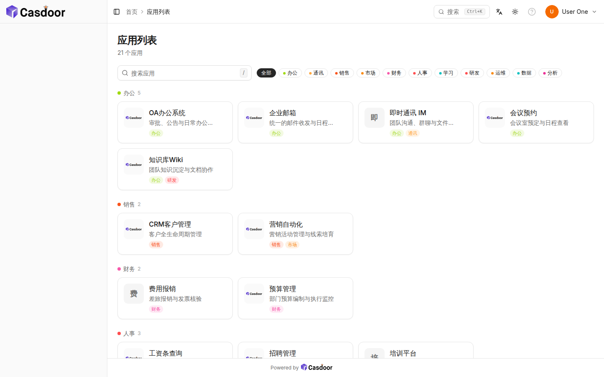
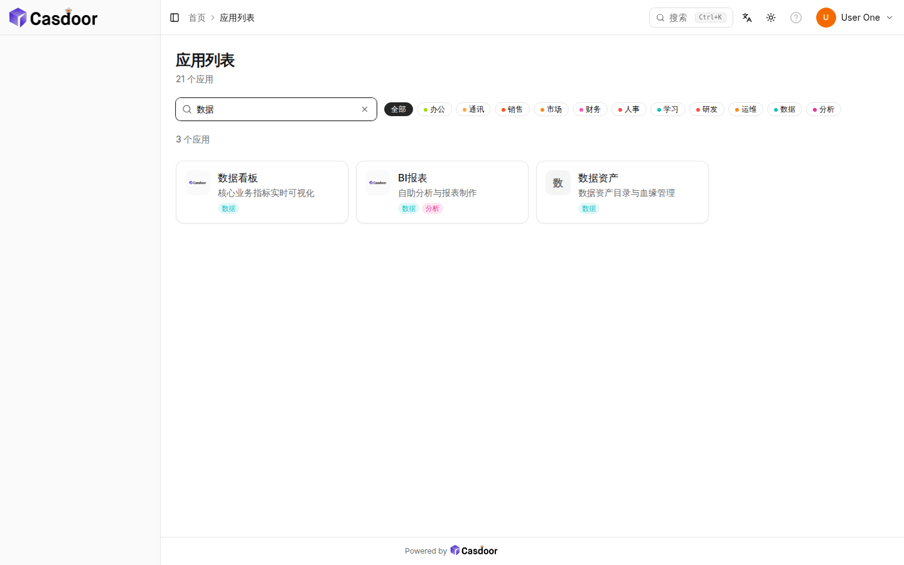
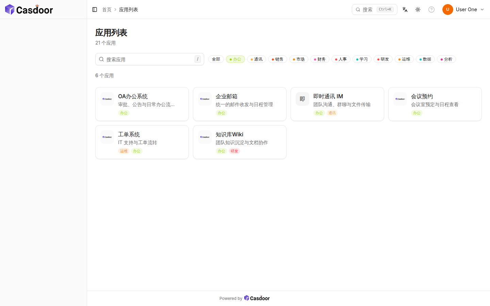
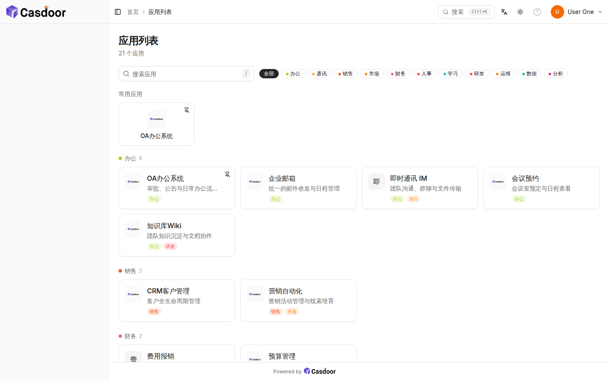
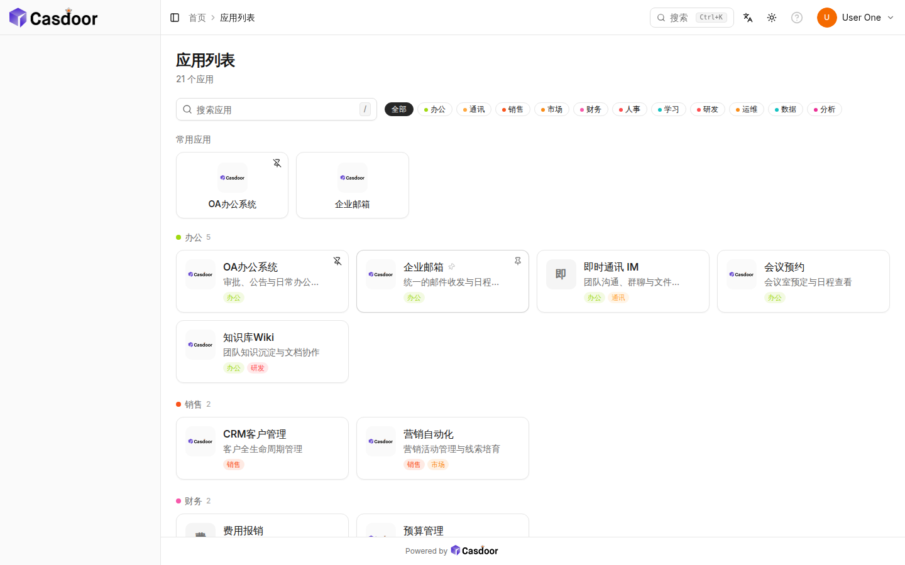
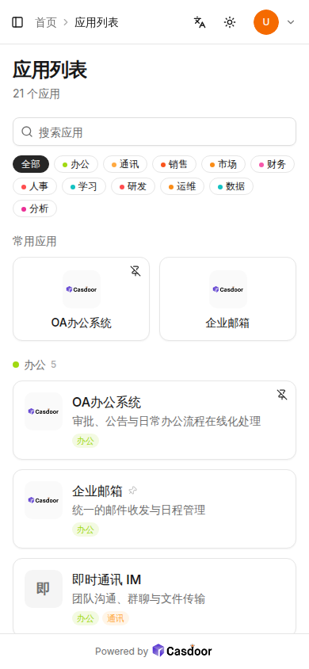

# 用户门户「应用列表」UI 优化方案

> 页面：`/apps`（用户登录门户的应用列表）
> 实现：`web/src/pages/AppListPage.tsx`（React + shadcn/ui + Tailwind）
> 验证日期：2026-10-29，验证数据：组织 `torg` 下 21 个应用（≥20 场景）

## 1. 背景与目标

改版前的 `/apps` 仅是一个平铺卡片网格 + 一排高饱和色块标签：

- 应用超过 20 个时只能逐行肉眼扫描，**没有搜索**；
- 标签使用 20 色高饱和底 + 白字，视觉噪音大，与门户整体的浅色系不协调；
- 没有「常用应用」概念，高频应用与低频应用混排；
- 无空状态、无结果计数、无键盘操作。

本次优化目标：**简洁统一的视觉风格** + **20+ 应用下的高效检索与定位**，具体能力为分类分组（标签筛选）、快捷搜索、常用应用置顶，并保持响应式适配。

## 2. 布局结构

页面自上而下分为 4 个区域，全部复用门户现有的 `PageHeader` 与栅格体系，不引入额外容器层级：

```
┌────────────────────────────────────────────────────────────┐
│ ① 页头  应用列表 / 「N 个应用」结果计数                        │
├────────────────────────────────────────────────────────────┤
│ ② 工具栏  [🔍 搜索应用  /]   (全部)(办公)(通讯)(销售)…标签胶囊  │
├────────────────────────────────────────────────────────────┤
│ ③ 常用应用（置顶优先 + 最近使用，≤8 个，紧凑磁贴网格）           │
│    ┌────┐ ┌────┐ ┌────┐ ┌────┐ ┌────┐ ┌────┐                │
├────────────────────────────────────────────────────────────┤
│ ④ 全部应用：默认按分类分组（每标签一个分区），筛选/搜索时平铺   │
│    ● 办公 5                                                   │
│    ┌──────────┐ ┌──────────┐ ┌──────────┐ ┌──────────┐      │
│    │ logo 名称 │ │          │ │          │ │          │      │
│    │      描述 │ │          │ │          │ │          │      │
│    │      标签 │ │          │ │          │ │          │      │
│    └──────────┘ └──────────┘ └──────────┘ └──────────┘      │
│    ● 销售 2 …（无标签应用归入末尾「未分类」分区）               │
└────────────────────────────────────────────────────────────┘
```

- **① 页头**：标题 + 应用总数（筛选时显示匹配数），一行说明文字承担「结果计数」职责，不额外加角标。
- **② 工具栏**：左侧搜索框（桌面端固定 `max-w-xs`，移动端全宽），右侧标签胶囊组自动换行；标签数多时不挤压搜索框（`lg` 以下换行堆叠）。
- **③ 常用应用**：仅在「未搜索且未筛选」且存在记录时出现；置顶应用排在最前，其余按最近打开时间排序，最多 8 个；采用 2/3/4/6 列紧凑磁贴（logo 居中 + 名称一行），与下方全量网格形成「快捷区 / 全量区」的视觉分层。
- **④ 全量区（分类分组）**：默认（无搜索、无筛选）按标签分组渲染——每个标签一个分区（应用归入其**首个标签**的分区），分区头为「色点 + 分类名 + 数量」，无标签应用归入末尾「未分类」分区；分区内为 1/2/3/4 列响应式卡片。搜索或标签筛选时切换为平铺结果网格，保证「分组浏览」与「精确检索」两种扫描路径。卡片内为「logo 磁贴 + 名称 + 单行描述 + 标签 chips」，行高固定、`line-clamp` 截断，保证 20+ 卡片时网格整齐。

## 3. 交互逻辑

| 交互 | 行为 |
|---|---|
| 快捷搜索 | 输入即过滤（displayName / name / description / tags 全字段匹配，不区分大小写）；`/` 键聚焦搜索框，`Esc` 或 ✕ 清空；搜索时区域标题实时显示「N 个应用」 |
| 标签筛选 | 胶囊多选（AND 语义，与旧版一致）；「全部」一键重置并回到分组视图；选中态用标签自身颜色的 14% 透明底 + 同色文字，未选中为描边胶囊 + 色点 |
| 分类分组 | 默认全量视图按标签分区（应用归入首个标签分区，无标签归「未分类」），分区头显示色点 + 分类名 + 数量；21 个应用被收敛为 8 个分区，逐区扫描即可定位 |
| 常用应用置顶 | 卡片悬停出现 Pin 按钮（已置顶常显），点击即置顶/取消；点击打开应用自动记录最近使用（localStorage，按 `组织:用户` 隔离，保留 20 条） |
| 打开应用 | 保持旧语义：新标签页打开应用 homepage 并附加 `silentSignin=1` 静默登录；`<custom-url>` 回退到用户主页 |
| 空状态 | 筛选无结果时显示虚线框 + 图标 + 「未找到匹配的应用」+ 重置按钮；应用列表为空不渲染网格 |
| 常用区与筛选互斥 | 搜索/筛选时隐藏常用区，避免「快捷区」干扰结果扫描 |

## 4. 视觉规范

全部基于门户现有 shadcn 设计令牌（`background / card / border / muted / muted-foreground / primary`），不新增色板：

- **卡片**：`rounded-lg` 白底卡片，`p-3.5`，悬停 `border-foreground/20 + shadow-sm`；无阴影堆叠、无渐变。
- **logo 磁贴**：48×48 `rounded-lg`，`bg-muted/50 + p-1` 内衬（logo 内容区 40px，与旧版视觉大小一致），任意宽高比 logo `object-contain` 居中；logo 缺失/加载失败回退 `bg-muted` 首字色块（`text-lg`），网格永不缺位。
- **标签 chips**：由旧版「高饱和底 + 白字」改为「12% 透明底 + 同色文字」的软色 chips（`color-mix(in srgb, color 12%, transparent)`），单卡最多 2 个 + `+N` 计数胶囊，消除 20 色噪音。
- **标签胶囊（筛选器）**：未选中 = 描边 + 8px 色点；选中 = 14% 透明底 + 35% 描边 + 同色文字；「全部」选中 = `primary` 实底。
- **文字层级**：页头 `text-2xl font-semibold`；区域/分组标题 `text-sm font-medium text-muted-foreground`（分组头带 8px 色点与 `text-xs` 数量）；卡片名 `font-medium` 单行截断；描述 `text-sm text-muted-foreground` 单行截断；chips `11px`。
- **间距节奏**：区域间 `space-y-5`，分组间 `space-y-6`，区域内 `space-y-2.5`，网格 `gap-3`，与门户其他页面（如 Marketplace）一致。
- **图标**：统一 lucide，功能图标 14–16px，`muted-foreground` 色。

## 5. 响应式适配

| 断点 | 工具栏 | 常用区 | 全量网格 |
|---|---|---|---|
| <640（手机） | 搜索全宽，标签换行 | 2 列磁贴 | 1 列 |
| ≥640 | 搜索全宽行内 | 3 列 | 2 列 |
| ≥1024 | 搜索 `max-w-xs` 与标签同行 | 4 列 | 3 列 |
| ≥1280 | 同上 | 6 列 | 4 列 |

手机视口（390×844）实测：无横向滚动，搜索框占满内容宽度，标签胶囊自动换行，常用磁贴 2 列。

## 6. 20+ 应用场景验证

测试数据：组织 `torg` 下 21 个应用（20 个带名称/描述/标签/主页的 demo 应用 + 1 个无主页应用），11 个标签分类，用户 `u1`。headless Chromium 真实交互验证，控制台零报错。

| 场景 | 截图 | 结论 |
|---|---|---|
| 21 应用分组展示（1440×900） |  | 默认按分类分组：办公 5 / 销售 2 / 财务 2 / 人事 3 / 研发 2 / 运维 3 / 数据 3 / 未分类 1 共 8 个分区，分区头色点 + 数量，页头显示「21 个应用」，视觉简洁 |
| 搜索「数据」 |  | 即时过滤出 3 个匹配应用，区域标题显示「3 个应用」，出现清除按钮 |
| 标签筛选「办公」 |  | 命中 6 个应用，选中胶囊软色高亮，多选/取消逻辑正确 |
| 悬停置顶 |  | Pin 按钮悬停浮现，点击后写入 localStorage 并立即出现常用区 |
| 常用应用区 |  | 刷新后常用区含「置顶的 OA + 最近打开的企业邮箱」，排序为置顶优先 + 最近使用；下方全量区按分类分区展示，对应卡片显示淡色 pin 标记 |
| 手机 390×844 |  | 单列布局、搜索全宽、无横向滚动，操作热区充足 |

结论：20+ 应用下，搜索可在 1 次击键内定位目标（`/` → 输入），标签筛选将 21 个应用收敛到 ≤6 个，分类分组将全量收敛为 8 个分区逐区扫描，常用区让 Top 8 高频应用一步直达；四种路径互补，均不破坏整体简洁风格。

## 7. 实现与数据说明

**代码变更**

- `web/src/pages/AppListPage.tsx`：整页重构（搜索、标签胶囊、常用/置顶、logo 磁贴、空状态、响应式网格）。
- `web/src/locales/{zh,en}/data.json`：新增 `general` 命名空间键：`Search applications`、`Clear search`、`Frequently used`、`No matching applications`、`Pin to top`、`Unpin`、`{count} applications`。
- 存储键：`casdoor-portal-apps:recent:{org}:{user}`、`casdoor-portal-apps:pinned:{org}:{user}`（localStorage，仅本机本用户）。

**验证用测试数据（如需清理）**

```sql
DELETE FROM application WHERE owner = 'admin' AND name LIKE 'demo-%';
DELETE FROM permission WHERE owner = 'torg' AND name = 'perm-portal-u1';
UPDATE "user" SET tag = '' WHERE owner = 'torg' AND name = 'u1';
```

（验证时为让非管理员 `u1` 可见 21 个应用，额外创建了权限 `perm-portal-u1` 并设置了 `u1.tag`；删除后恢复原有权限过滤行为。）
